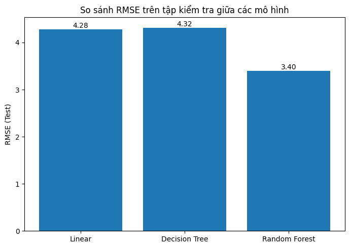

# Boston Housing Price Forecast

Phân tích dữ liệu Boston Housing và dự báo biến `MEDV` bằng Linear Regression, Decision Tree và Random Forest. Notebook bao gồm EDA, biến đổi đặc trưng, tìm kiếm siêu tham số và so sánh kết quả hồi quy.

## Mục tiêu

Dự án khảo sát một quy trình hồi quy từ khám phá dữ liệu đến đánh giá mô hình. Ba họ mô hình được đặt cạnh nhau để quan sát sự khác biệt giữa quan hệ tuyến tính, cây quyết định và tổ hợp nhiều cây. Notebook trình bày cả biểu đồ phân tích lẫn các bước xử lý, giúp người đọc theo dõi mối liên hệ giữa dữ liệu đầu vào và kết quả dự báo.

Đầu vào là các thuộc tính mô tả khu vực dân cư trong bộ Boston Housing. Đầu ra là `MEDV`, giá trị trung vị của nhà ở trong dữ liệu. Bài toán được triển khai bằng Python và scikit-learn, với pandas phục vụ xử lý bảng và matplotlib/seaborn phục vụ trực quan hóa.

## Dữ liệu và cấu trúc

| Tệp | Nội dung |
|---|---|
| `data/boston.csv` | Dữ liệu đầu vào, biến mục tiêu `MEDV` |
| `bieu_do.ipynb` | Notebook phân tích và huấn luyện |
| `Bao_cao.pdf` | Báo cáo của dự án |

CSV gồm **506 dòng, 13 biến đầu vào và một biến mục tiêu**. `MEDV` được biểu diễn theo nghìn USD. File dữ liệu được cung cấp trực tiếp trong repo: sau khi clone, có thể mở [boston.csv](data/boston.csv) mà không cần thêm bước tải riêng.

Một số biến được sử dụng trong phân tích:

| Biến | Ý nghĩa |
|---|---|
| `RM` | Số phòng trung bình của một căn nhà |
| `AGE` | Tỷ lệ nhà xây dựng trước năm 1940 |
| `DIS` | Khoảng cách có trọng số tới các trung tâm việc làm |
| `TAX` | Thuế suất bất động sản trong bộ dữ liệu |
| `PTRATIO` | Tỷ lệ học sinh/giáo viên theo khu vực |
| `MEDV` | Biến mục tiêu hồi quy |

Các tên cột gốc được giữ nguyên để thuận tiện đối chiếu giữa CSV, biểu đồ và notebook. Đây là dữ liệu lịch sử dùng cho thực nghiệm hồi quy; đơn vị và bối cảnh dữ liệu cần được giữ khi diễn giải dự báo.

## Cài đặt và chạy

```powershell
git clone https://github.com/daotrunghieuk4/Boston-housing-price-forecast.git
cd Boston-housing-price-forecast
python -m venv .venv
.venv\Scripts\Activate.ps1
python -m pip install -r requirements.txt
python -m notebook bieu_do.ipynb
```

Trên Linux/macOS, dùng `source .venv/bin/activate`. Trong Jupyter, chọn **Restart Kernel and Run All Cells**. Notebook đọc `data/boston.csv` tương đối với thư mục gốc repo. RandomizedSearchCV thực hiện nhiều lượt fit và có thể mất vài phút.

## Quy trình thực nghiệm

1. **Khám phá dữ liệu:** đọc CSV, khảo sát phân phối và quan hệ giữa các thuộc tính.
2. **Chuẩn bị đặc trưng:** khảo sát biến đổi log cho `CRIM`, `ZN`, `B`, `LSTAT`, chuẩn hóa đặc trưng và xử lý miền giá trị `RM` trong notebook.
3. **Tách dữ liệu:** xây dựng các tập huấn luyện và kiểm tra theo cấu hình đã ghi trong mã.
4. **Huấn luyện:** so sánh Linear Regression với Decision Tree và Random Forest; tìm siêu tham số cho các mô hình cây bằng RandomizedSearchCV.
5. **Đánh giá:** tổng hợp RMSE, R² và trực quan hóa kết quả để so sánh các mô hình trong cùng thí nghiệm.

| Mô hình | Vai trò trong so sánh |
|---|---|
| Linear Regression | Mốc tham chiếu cho quan hệ tuyến tính |
| Decision Tree | Mô hình phân chia không gian đặc trưng theo các điều kiện |
| Random Forest | Tổ hợp nhiều cây nhằm cải thiện khả năng khái quát |

## Kết quả thực nghiệm

Notebook chia train/test theo tỷ lệ 80/20 với `random_state=42`, dùng cross-validation 5 folds để tìm cấu hình cây hồi quy và Random Forest.

| Mô hình | RMSE test | R² test |
|---|---:|---:|
| Linear Regression | 4.2807 | 0.7501 |
| Decision Tree | 4.3161 | 0.7460 |
| Random Forest | 3.4014 | 0.8422 |

Bảng tổng hợp từ output của notebook, trong đó Random Forest có RMSE thấp nhất và R² cao nhất trong ba mô hình được khảo sát. RMSE càng nhỏ biểu thị sai số càng thấp; R² mô tả mức độ giải thích biến thiên của mục tiêu trong phép đánh giá. [Notebook](bieu_do.ipynb) · [Báo cáo](Bao_cao.pdf)




## Tái lập và mở rộng thí nghiệm

Để đối chiếu với bảng kết quả, giữ nguyên dữ liệu, thứ tự các cell và cấu hình chia tập. Notebook hiện áp dụng một số phép tiền xử lý trước bước chia dữ liệu; khi xây dựng phép đối chứng với các công trình khác, đặt các phép biến đổi học từ dữ liệu vào pipeline được fit trên tập train của từng fold.

Không gian tìm kiếm Random Forest trong notebook có giá trị `max_features='auto'` của cấu hình gốc. Với phiên bản scikit-learn không hỗ trợ giá trị này, dùng `1.0` cho lựa chọn xét toàn bộ đặc trưng hoặc chỉ giữ các lựa chọn hợp lệ trước khi chạy lại. Kết quả của cấu hình cập nhật nên được ghi thành một lần thực nghiệm riêng.

Để thử một mô hình mới, sử dụng cùng cách chia dữ liệu và cùng chỉ số đánh giá, sau đó bổ sung một dòng vào bảng so sánh. Lưu phiên bản thư viện, siêu tham số và output tương ứng để việc đối chiếu giữa các lần chạy được rõ ràng.

## Tài liệu

- [Notebook phân tích và huấn luyện](bieu_do.ipynb)
- [Báo cáo dự án](Bao_cao.pdf)
- [Biểu đồ RMSE](figures/test-rmse.png)
